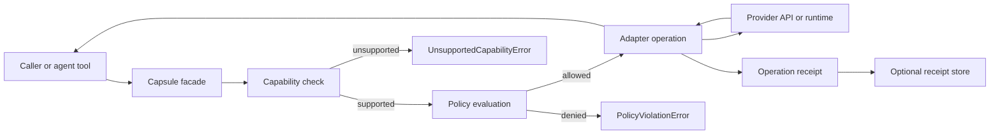
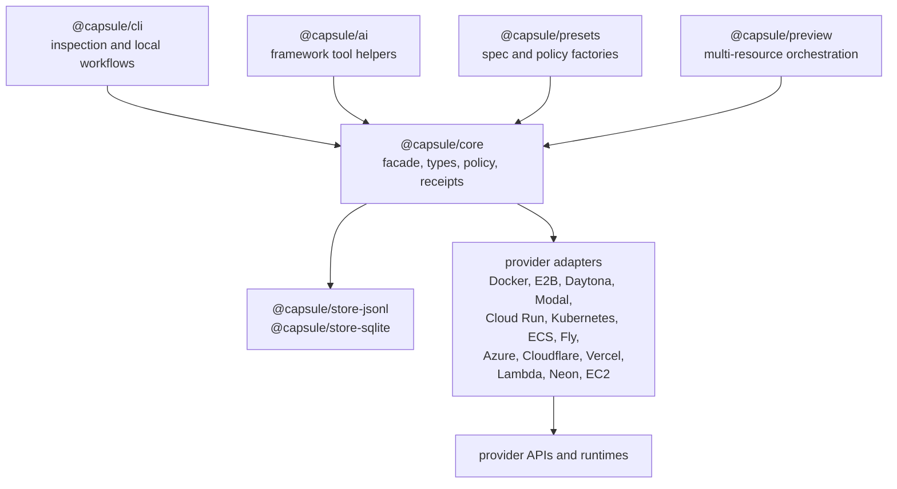
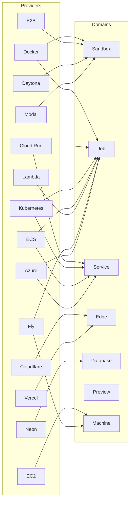

# Capsule

[](https://github.com/EfeDurmaz16/capsule/actions/workflows/ci.yml)
[](LICENSE)


One TypeScript layer for running code across cloud runtimes: sandboxes, jobs, services, edge deploys, database branches, preview environments, and machines.

A `Capsule` is a small facade you construct around one provider adapter. Every call through it is capability-checked, policy-checked, and recorded as a receipt:

```ts
import { Capsule } from "@capsule/core";
import { docker } from "@capsule/adapter-docker";

const capsule = new Capsule({
  adapter: docker(),
  policy: {
    network: { mode: "none" },
    limits: { timeoutMs: 60_000 }
  },
  receipts: true
});

const box = await capsule.sandbox.create({ image: "node:22" });

await box.writeFile("/workspace/index.js", "console.log('hello from capsule')");
const result = await box.exec({ command: ["node", "/workspace/index.js"] });

console.log(result.stdout);
console.log(result.receipt);

await box.destroy();
```

Swap `docker()` for `e2b()`, `daytona()`, `modal()`, or any other adapter and the sandbox code above stays the same. Adapters exist for Docker, E2B, Daytona, Modal, Cloud Run, Cloudflare Workers, Vercel, Kubernetes, AWS Lambda, ECS/Fargate, EC2, Fly Machines, Azure Container Apps, and Neon.

Capsule does not pretend these providers are the same. Adapters declare a support level for every operation (`native`, `emulated`, `experimental`, `unsupported`), and anything a provider cannot do fails loudly with a typed error instead of being faked.

## Why Capsule

- **Capability negotiation.** `capsule.supports("edge.rollback")` and `capsule.supportLevel("database.branchCreate")` tell you before you call whether an operation is native, emulated, experimental, or unsupported on the chosen provider.
- **Policy before execution.** Network, filesystem, secrets, limits, cost, TTL, and approval policies are evaluated before the provider call, and the decision is recorded.
- **Execution receipts.** Every action produces a normalized record: provider, adapter, capability path, support level, timing, SHA-256 output hashes, resource ids, and the policy decision. Receipts can be persisted to JSONL or SQLite and composed into verifiable evidence bundles.
- **Escape hatch, not a cage.** `raw()` returns the native provider client when you need the full API. Calls through it skip Capsule's checks and receipts by design.
- **Preview composition.** A database branch, an edge deploy, a service, and check jobs compose into one preview environment with URLs, a cleanup plan, and evidence.
- **Agent-ready.** `@capsule/ai` ships a code execution tool plus dependency-free tool descriptors for the Vercel AI SDK, OpenAI Agents/Responses, LangChain, Mastra, and CrewAI.

Use a provider SDK directly when you build for one provider and need its full native API. Use Capsule when an agent platform, CI system, preview controller, or internal tool has to operate across providers and prove what happened. The longer argument lives in the [manifesto](docs/manifesto.md) and the [comparison](docs/comparison.md) (including how Capsule differs from ComputeSDK, Terraform/Pulumi, Nitric/Encore, and plain provider SDKs).

## How Capsule Works

Every operation through Capsule follows a governed path:



1. **Capability check** - Is the operation supported on this adapter? (native/emulated/experimental/unsupported)
2. **Policy evaluation** - Network, filesystem, secrets, limits, cost, TTL, approval policies
3. **Adapter execution** - Provider-specific implementation
4. **Receipt generation** - Normalized evidence record with SHA-256 hashes
5. **Optional persistence** - JSONL or SQLite storage

## Status

Capsule is pre-1.0 and **not published to npm yet**. The `@capsule/*` package names in this README are the reserved names for the first release; today you run Capsule from this repository:

```bash
git clone https://github.com/EfeDurmaz16/capsule.git
cd capsule
pnpm install
pnpm build

# credential-free examples (mock adapters, no provider accounts needed)
pnpm --filter @capsule/example-capability-check start
pnpm --filter @capsule/example-policy-receipts start

# Docker-backed examples (require a local Docker daemon)
pnpm --filter @capsule/example-sandbox-docker start
pnpm --filter @capsule/example-job-docker start

# the CLI
pnpm --filter @capsule/cli exec node dist/index.js doctor
```

After the first npm release the install will be the usual per-adapter form:

```bash
pnpm add @capsule/core @capsule/adapter-docker
```

Install only the adapters you use. `@capsule/adapter-mock` is for tests and examples; it never calls real provider APIs. The full release gate is tracked in [publish readiness](docs/publish-readiness.md).

## Package Structure

Capsule is a pnpm monorepo with focused packages:



## Domains

Each domain is a namespace on the `Capsule` facade with its own spec types:

```ts
await capsule.sandbox.create({ image: "node:22" }); // interactive execution
await capsule.job.run({ image: "node:22", command: ["node", "-e", "console.log(1)"] }); // one-shot runs
await capsule.service.deploy({ name: "api", image: "example/api:latest" }); // long-running services
await capsule.edge.deploy({ name: "worker", runtime: "workers" }); // edge functions
await capsule.database.branch.create({ project: "app", name: "pr-42" }); // database branches
await capsule.preview.create({ name: "pr-42" }); // composed preview environments
await capsule.machine.create({ name: "runner", image: "ubuntu-24.04" }); // raw VMs
```

## Provider Matrix

Which domains actually work on which provider. Support levels are declared by each adapter; `unsupported` operations throw `UnsupportedCapabilityError` instead of pretending.

| Provider             | Package                                 | Sandbox     | Job         | Service     | Edge        | Database    | Preview     | Machine     |
| -------------------- | --------------------------------------- | ----------- | ----------- | ----------- | ----------- | ----------- | ----------- | ----------- |
| Docker               | `@capsule/adapter-docker`               | native      | native      | unsupported | unsupported | unsupported | unsupported | unsupported |
| E2B                  | `@capsule/adapter-e2b`                  | native      | unsupported | unsupported | unsupported | unsupported | unsupported | unsupported |
| Daytona              | `@capsule/adapter-daytona`              | native      | unsupported | unsupported | unsupported | unsupported | unsupported | unsupported |
| Modal                | `@capsule/adapter-modal`                | native      | unsupported | unsupported | unsupported | unsupported | unsupported | unsupported |
| Cloud Run            | `@capsule/adapter-cloud-run`            | unsupported | native      | native      | unsupported | unsupported | unsupported | unsupported |
| Cloudflare Workers   | `@capsule/adapter-cloudflare`           | unsupported | unsupported | unsupported | native      | unsupported | unsupported | unsupported |
| Vercel               | `@capsule/adapter-vercel`               | unsupported | unsupported | unsupported | native      | unsupported | unsupported | unsupported |
| Neon                 | `@capsule/adapter-neon`                 | unsupported | unsupported | unsupported | unsupported | native      | unsupported | unsupported |
| Kubernetes           | `@capsule/adapter-kubernetes`           | unsupported | native      | native      | unsupported | unsupported | unsupported | unsupported |
| Lambda               | `@capsule/adapter-lambda`               | unsupported | native      | unsupported | unsupported | unsupported | unsupported | unsupported |
| ECS/Fargate          | `@capsule/adapter-ecs`                  | unsupported | native      | native      | unsupported | unsupported | unsupported | unsupported |
| EC2                  | `@capsule/adapter-ec2`                  | unsupported | unsupported | unsupported | unsupported | unsupported | unsupported | native      |
| Fly Machines         | `@capsule/adapter-fly`                  | unsupported | native      | unsupported | unsupported | unsupported | unsupported | native      |
| Azure Container Apps | `@capsule/adapter-azure-container-apps` | unsupported | native      | native      | unsupported | unsupported | unsupported | unsupported |

Every adapter above is a real SDK- or API-backed integration. `@capsule/adapter-mock` additionally models these providers with fake objects and receipts for tests and examples. The `preview` column is empty because previews are composed from the other domains by `@capsule/preview` rather than provided natively; see [preview environments](docs/preview-environments.md). Remaining per-provider gaps are listed in the [gap register](docs/real-provider-gap-register.md).

### Domain Coverage by Provider



## Capabilities

```ts
capsule.supports("sandbox.exec"); // boolean
capsule.supportLevel("service.deploy"); // "native" | "emulated" | "experimental" | "unsupported"
capsule.capabilities(); // full declared map
capsule.adapterName();
capsule.raw(); // native provider client, bypasses all Capsule checks
```

Details: [capability model](docs/capability-model.md).

## Policy and Receipts

Policies run before runtime actions and their decision is embedded in the receipt. Receipts record what Capsule observed: they are normalized, hashable, optionally signed, and persistable through `@capsule/store-jsonl` or `@capsule/store-sqlite`. They are evidence of observation, not absolute truth.

Details: [policy model](docs/policy-model.md), [execution receipts](docs/execution-receipts.md), [security model](docs/security-model.md).

## Presets

Presets are spec and policy factories for common shapes. They do not execute anything and they carry the capability paths a caller should check first:

```ts
import { Capsule, nodeSandboxPreset } from "@capsule/core";
import { docker } from "@capsule/adapter-docker";

const preset = nodeSandboxPreset({ timeoutMs: 30_000, secretEnv: ["NPM_TOKEN"] });

const capsule = new Capsule({ adapter: docker(), policy: preset.policy, receipts: true });

for (const path of preset.capabilityPaths) {
  if (!capsule.supports(path)) throw new Error(`Adapter does not support ${path}`);
}

const sandbox = await capsule.sandbox.create(preset.spec);
```

Core ships `nodeSandboxPreset`, `nodeJobPreset`, `httpServicePreset`, `edgeWorkerPreset`, `previewDatabaseBranchPreset`, and `previewEnvironmentPreset`. Provider-oriented compositions such as `flyVercelNeonPreviewPreset` live in `@capsule/presets`.

## CLI

```bash
capsule init --adapter docker --out-dir .
capsule doctor
capsule capabilities --adapter neon
capsule examples run capability-check
capsule policy explain --adapter docker --capability job.run --policy-file policy.json --spec-file job-spec.json
capsule receipt verify --receipt-file .capsule/receipts.jsonl
capsule preview create --config-file preview.json --cleanup-file .capsule/preview-cleanup.json
```

`capsule doctor` checks Node support, workspace health, Docker availability, and provider credential env vars without printing secret values. Report commands take `--json` for automation. Run `capsule --help` for the full command list, including provider-specific `service`, `job`, and `neon` commands.

`capsule init` scaffolds a `capsule.config.json`. Commands read it from the working directory and apply its `adapter`, `receipts.path`, and `policyFile` when the matching flag is not passed; explicit flags always override the config file. The scaffolded policy sets `secrets.allowed` to `[]`, which denies every environment key by default until you add keys to it.

## Packages

| Package                                         | What it is                                                                                            |
| ----------------------------------------------- | ----------------------------------------------------------------------------------------------------- |
| `@capsule/core`                                 | Domain types, the `Capsule` facade, capabilities, policy, receipts, errors, presets, adapter contract |
| `@capsule/adapter-*`                            | One real adapter per provider (see the matrix above), plus `adapter-mock` for tests                   |
| `@capsule/ai`                                   | Code execution tool and tool descriptors for AI frameworks                                            |
| `@capsule/preview`                              | Preview environment composition, cleanup plans, evidence bundles                                      |
| `@capsule/presets`                              | Provider-oriented spec factories                                                                      |
| `@capsule/store-jsonl`, `@capsule/store-sqlite` | Receipt persistence                                                                                   |
| `@capsule/cli`                                  | The `capsule` CLI                                                                                     |

## Known Limitations

- Capsule is not a sandbox by itself; isolation comes from the provider. Local Docker is not safe for hostile untrusted code by default.
- Policy enforcement depends on adapter and provider support; unsupported enforcement is reported, not silently assumed.
- Receipts are not signed attestations yet unless you configure a signer.
- Hosted persistence, auth, dashboards, queues, and server APIs are intentionally outside core.

## Docs

Start here:

- [Architecture](docs/architecture.md) and [diagrams](docs/architecture-diagrams.md)
- [Adapter contract](docs/adapter-contract.md) and [adding a provider adapter](docs/adding-provider-adapter.md)
- [Capability model](docs/capability-model.md), [policy model](docs/policy-model.md), [execution receipts](docs/execution-receipts.md)
- [Real provider quickstarts](docs/real-provider-quickstarts.md) and [live provider tests](docs/live-tests.md)
- [Provider matrix](docs/provider-matrix.md) and [provider selection](docs/provider-selection.md)
- [Security model](docs/security-model.md)
- [Manifesto](docs/manifesto.md), [comparison](docs/comparison.md), [roadmap](docs/roadmap.md)
- [API reference](docs/api-reference.md) (generated by `pnpm docs:api`)
- Everything else: [docs/](docs/), including ADRs under [docs/adr/](docs/adr/README.md)

## Development

```bash
pnpm install
pnpm build
pnpm test
pnpm typecheck
```

Adapter contributions should include a capability map, docs, and the shared contract tests. See [contributing](docs/contributing.md).

## License

[MIT](LICENSE)
