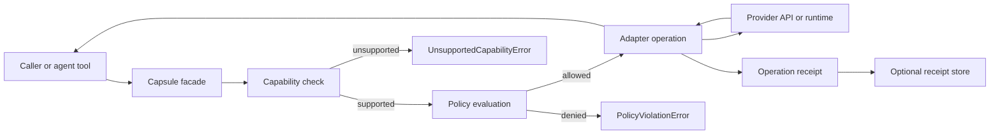
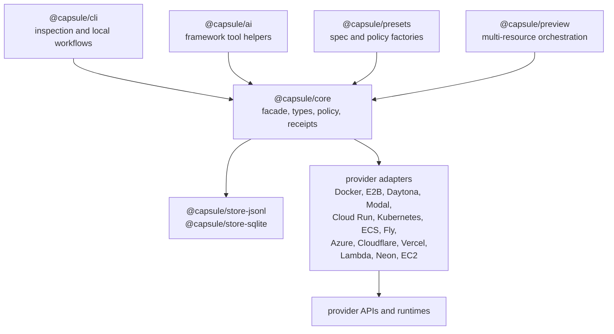
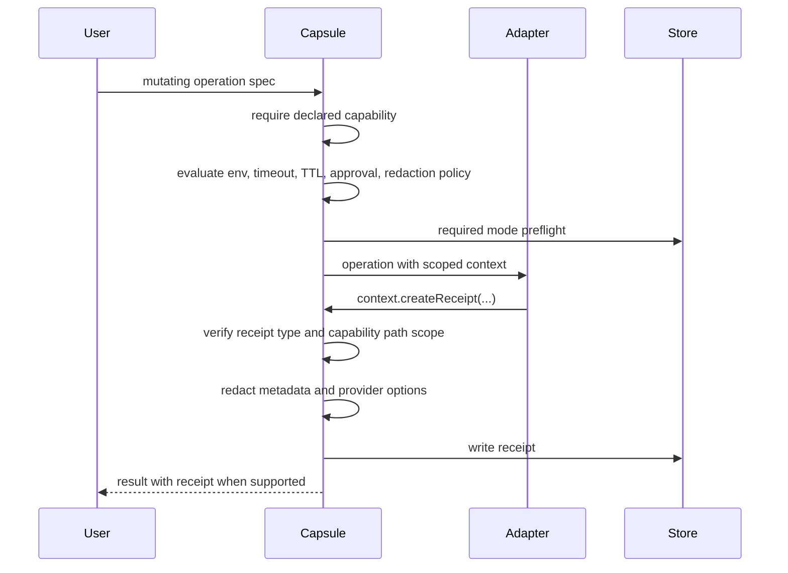
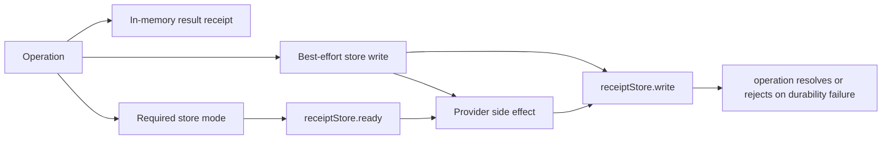
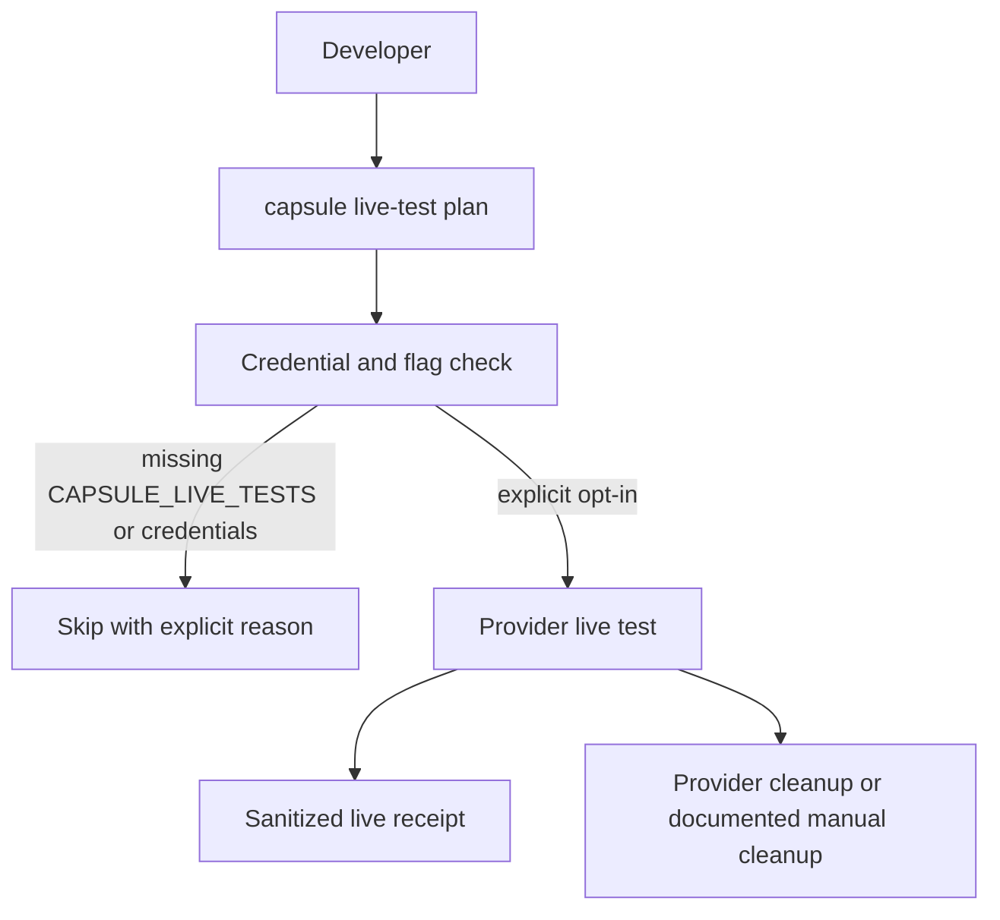
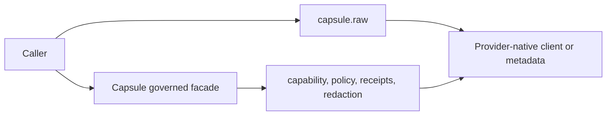

# Architecture Diagrams

These diagrams are source-of-truth documentation. Update them when the core facade, adapter boundary, policy path, receipt stores, or live-test workflow changes.

## Governed Operation Path

## Package Boundary

## Policy And Receipt Scope

## Receipt Store Modes

## Live Test Gate

## Raw Escape Hatch Boundary

`raw()` is intentionally outside the governed path. Use it for provider-native inspection or setup, not for audited execution.
