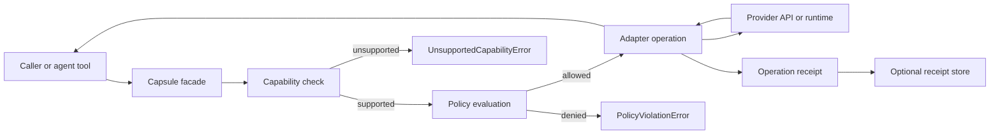
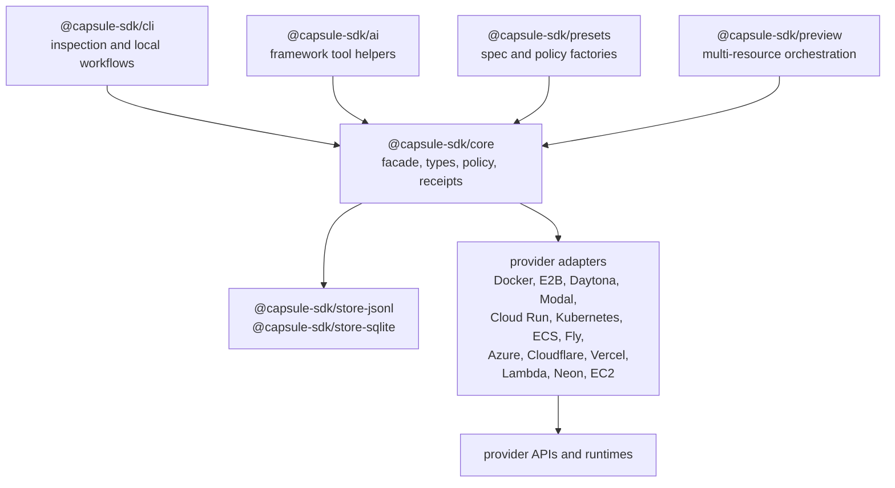
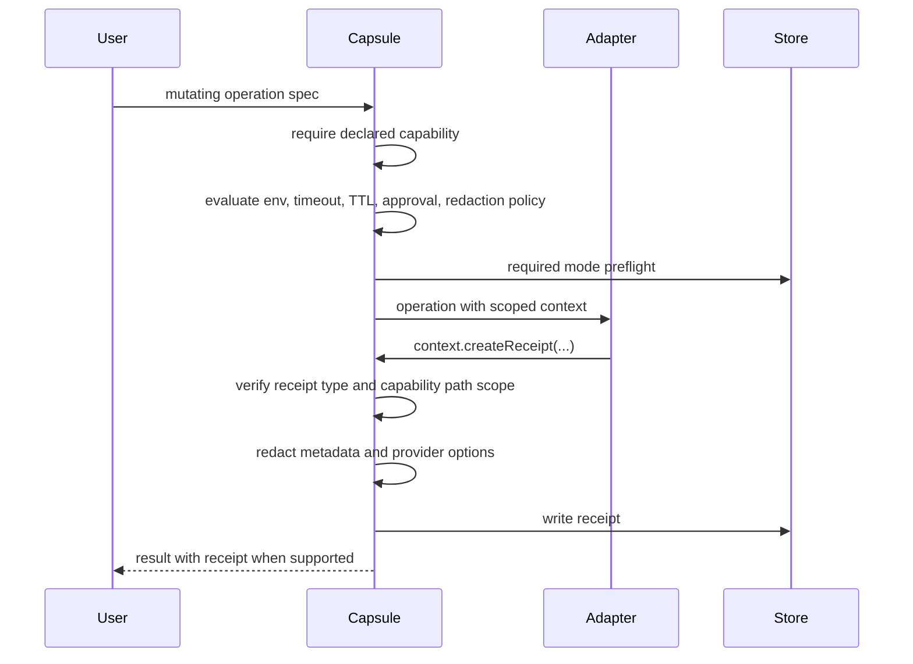
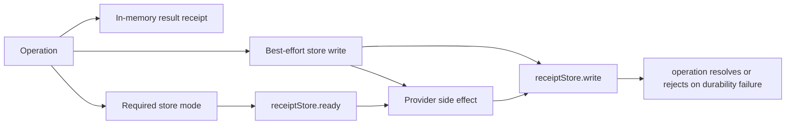
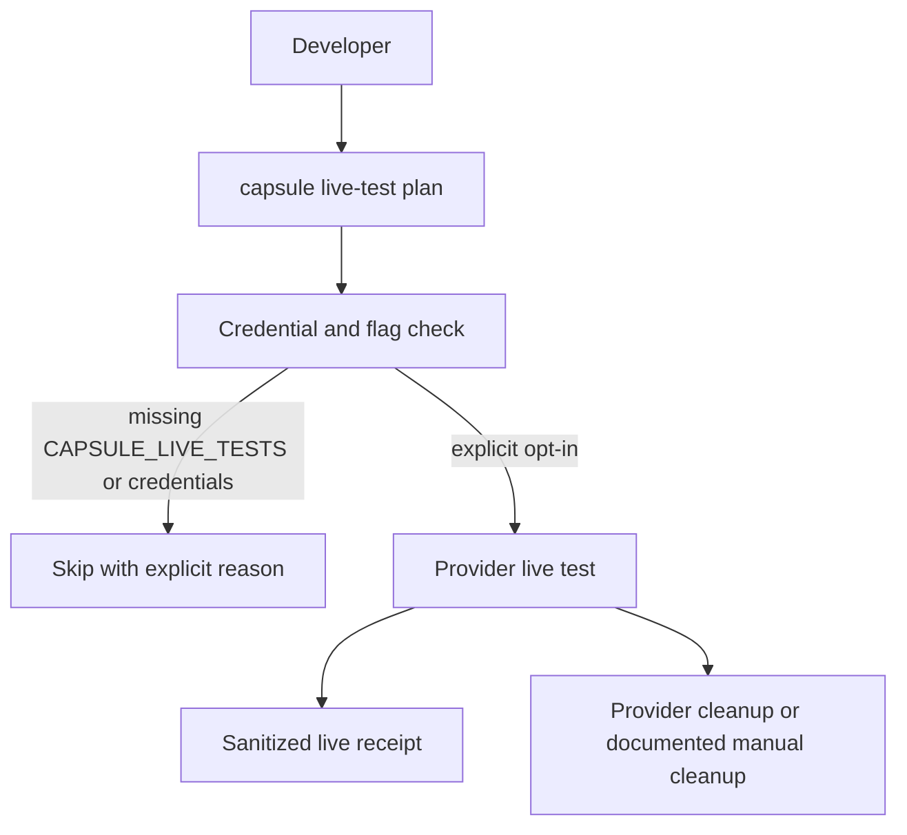
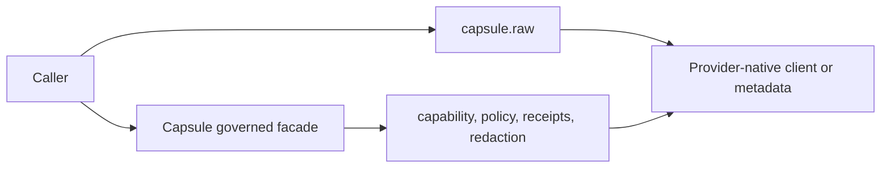

# Architecture

Capsule is a pnpm monorepo with focused packages:

- `@capsule-sdk/core`: shared types, capability lookup, policy checks, receipts, domain facades, contract helpers, and errors.
- `@capsule-sdk/docker`, `@capsule-sdk/e2b`, `@capsule-sdk/daytona`, and `@capsule-sdk/modal`: sandbox execution adapters with provider-specific lifecycle semantics.
- `@capsule-sdk/cloud-run`, `@capsule-sdk/kubernetes`, `@capsule-sdk/ecs`, `@capsule-sdk/fly`, and `@capsule-sdk/azure`: container job/service adapters.
- `@capsule-sdk/cloudflare`, `@capsule-sdk/vercel`, and `@capsule-sdk/lambda`: edge, function, deployment, and runtime adapters.
- `@capsule-sdk/neon`: database branch resource adapter.
- `@capsule-sdk/ec2`: machine lifecycle adapter.
- `@capsule-sdk/mock`: realistic mock providers for examples, tests, and future adapter design.
- `@capsule-sdk/ai`: framework-agnostic code execution tool helper and dependency-free framework descriptors for Vercel AI SDK, OpenAI Agents/Responses, LangChain, Mastra, and CrewAI.
- `@capsule-sdk/cli`: CLI for capabilities, provider comparison, live-test planning, Docker runs, sandbox smoke tests, adapter scaffolding, and doctor checks. `capsule doctor` reports Node support, workspace health, package versions, release-audit script availability, Docker availability, and provider credential env-var presence without printing secret values.
- `@capsule-sdk/presets`: provider-oriented runtime and preview preset factories.
- `@capsule-sdk/preview`: preview environment composition helpers for resources, cleanup evidence, and receipts.
- `@capsule-sdk/store-jsonl` and `@capsule-sdk/store-sqlite`: receipt persistence packages.
- `@capsule-sdk/test-utils`: private workspace helpers for contract and live provider tests.

The `Capsule` class receives an adapter, optional policy, and receipt setting. Domain APIs such as `capsule.sandbox.create` and `capsule.job.run` validate capability paths, evaluate policy, call the adapter, and attach receipts where the domain result supports them.

Adapters declare a `CapabilityMap`. `supports(path)` returns true only for `native`, `emulated`, or `experimental`. `supportLevel(path)` returns the declared level or `unsupported`.

Policy evaluation runs before adapter execution. Core checks secrets, merges timeout limits, records policy notes, and exposes enough context for adapters to enforce provider-native controls. Adapters add notes for delegated, unsupported, or best-effort enforcement.

Receipts are generated by core helpers using SHA-256 hashes for stdout, stderr, and artifacts. Optional receipt signing exists today: a caller-configured `ReceiptSigner` signs the canonical unsigned receipt payload, and `verifyReceipt` or `capsule receipt verify --public-key` checks it (see [execution receipts](execution-receipts.md)). A signature authenticates Capsule's own payload, not provider truth. Provider attestations and the evidence-grade receipt profile ([ADR 0005](adr/0005-evidence-grade-receipts.md)) are separate, future guarantees.

Architecture decisions that affect the public SDK boundary are tracked in [ADRs](adr/README.md). The first records explain why Capsule v1 uses plain strict TypeScript instead of Effect in core, why the SDK core has no bundled database/server/dashboard, why provider boundaries are adapter-first, and why receipts are observational evidence rather than absolute proof.

## Runtime Domains

Capsule carves runtime into distinct domains instead of a single universal compute abstraction, so provider differences stay visible. Full per-domain behavior lives in [domain references](domains.md).

- **Sandbox**: isolated workspace for agent or user-generated code. Create, exec, file operations, logs, artifacts, snapshots, port exposure, and destruction. Local Docker, E2B, Daytona, Modal, Cloudflare Sandbox, Microsandbox, and future microVM adapters.
- **Job or function**: finite-duration compute. One-off containers, Cloud Run Jobs, ECS tasks, Kubernetes Jobs, Lambda invocations, Modal functions, and Fly Machines one-shot execution.
- **Service deployment**: long-running HTTP or TCP compute. Cloud Run Services, ECS/Fargate Services, Kubernetes Deployments, Azure Container Apps, and Fly Apps. Needs health checks, URLs, scaling, rollback, env, and logs.
- **Edge runtime**: Vercel deployments/functions, Cloudflare Workers/Pages/Containers, and Lambda-style functions with routes, bindings, versions, and releases. Separate from services because deployment, routing, global distribution, and platform bindings differ.
- **Database or resource**: managed deployment-adjacent resources such as Neon branches, D1, KV, R2, and future Supabase or PlanetScale branches. Needs connection strings, branch lifecycle, migrations, snapshots, and receipts.
- **Preview environment**: composes services, edge runtimes, database branches, jobs, URLs, logs, artifacts, TTL policy, and cleanup. Orchestration, not a single provider object.
- **Machine or VM**: lower-level VM or bare-metal control (create, exec, start, stop, snapshot, volumes, networking). EC2, GCE, Azure VM, bare metal, Nomad, and Firecracker. Powerful but leaks provider details heavily.

## Diagrams

These diagrams are source-of-truth documentation. Update them when the core facade, adapter boundary, policy path, receipt stores, or live-test workflow changes.

### Governed Operation Path

### Package Boundary

### Policy And Receipt Scope

### Receipt Store Modes

### Live Test Gate

### Raw Escape Hatch Boundary

`raw()` is intentionally outside the governed path. Use it for provider-native inspection or setup, not for audited execution.
